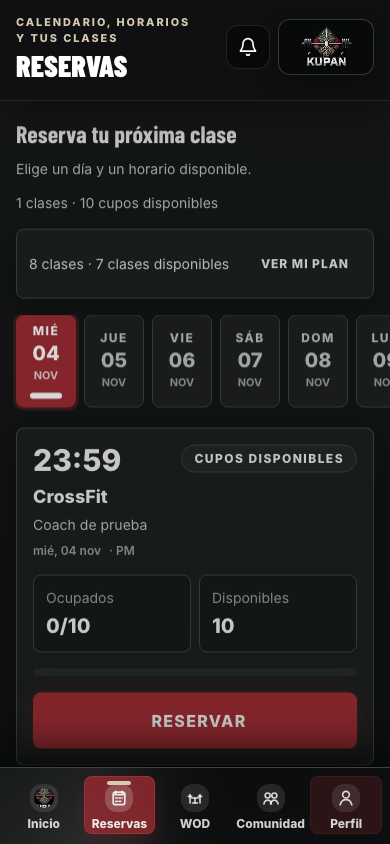

# Etapa 3 — fluidez y acabado

> Actualización 04-11-2026: integrada y publicada con KUPAN 2.2.1. El estado local y los pasos pendientes descritos originalmente abajo quedan resueltos en [el registro de publicación](publicacion-2026-11-04.md).

Implementada sobre las etapas 1 y 2 en `fix/etapa-3-fluidez`. No publicada en producción.

## Puntos 16–23

16. **Accesos contextuales:** «Mi plan» abre `/perfil?tab=membership`. «Registrar resultado» abre `/wod?action=result`, con el WOD cargado, fecha, nivel del atleta cuando esté definido y formato declarado por el entrenamiento (incluido AMRAP). El formulario se abre una sola vez desde ese acceso, sin reabrirse por una actualización de sesión.
17. **Volver después de entrar:** el acceso conserva una ruta interna validada, incluido el día de reserva. No acepta destinos externos, rutas de login recursivas ni barras inversas. Se conserva el destino tras un cambio obligatorio de contraseña. Iniciar sesión no reserva ni envía resultados automáticamente.
18. **Perfil:** secciones Membresía, Cuenta y Ajustes. Plan y próxima clase en Membresía; datos y edición en Cuenta; seguridad, meta y privacidad en Ajustes. Cerrar sesión queda en Ajustes. El resumen semanal y acceso a marcas pasan a la vista WOD; no se añadieron los gráficos previstos para la etapa 4. Las secciones conservan su estado al cambiar de pestaña.
19. **Atleta/Gestión:** cabecera con cambio de modo para administradores y coaches activos. Se mantienen los permisos de rutas; ocultar el enlace no sustituye el control de acceso. El coach no recibe un acceso de edición al panel admin.
20. **Reservas móvil:** resumen de acceso en una línea, cifras en texto, calendario compacto y menos encabezados repetidos. La prueba a 390 × 844 confirma que el primer botón «Reservar» queda visible por encima de la navegación inferior, con datos de prueba y sin desplazamiento previo. Inicio dirige al día de la clase sugerida.
21. **Acabado:** se mantiene la identidad de KUPAN. Se reduce el uso de mayúsculas en contenido, brillos de botones, repetición de bloques y texto de cabecera en Perfil. La navegación inferior utiliza etiquetas más legibles.
22. **Accesibilidad:** pestañas compartidas con flechas, Home/End, selección y una sola parada de Tab; paneles identificados. Diálogos con identificadores únicos, foco inicial, retorno del foco, fondo principal inerte y lista de controles recalculada al pulsar Tab. Escribir en un diálogo ya no vuelve a enfocar el botón de cierre por cada render. Enlace para saltar al contenido, foco de página al cambiar de ruta, encabezados sin duplicar el principal, mayor contraste de textos secundarios y respeto a movimiento reducido. Prueba de texto ampliado al 200 % sin desbordamiento horizontal en Perfil. No se declara conformidad WCAG completa ni prueba con lector de pantalla.
23. **Actualizaciones:** el botón del pie consulta actualizaciones sin desregistrar el service worker ni borrar cachés indiscriminadamente. Los avisos se posponen por versión durante la sesión. La primera instalación y la activación desde otra pestaña no recargan la página automáticamente. Si hay un formulario modificado, se ofrece volver para guardarlo o descartarlo explícitamente antes de recargar. Las instantáneas de formulario son solo de memoria: no se guardan contraseñas ni contenido en almacenamiento persistente. Guardados exitosos de formularios principales actualizan su referencia sin marcar cambios posteriores como guardados.

## Verificación

- Lint, suite general (incluye etapas 1, 2 y rutas de retorno de etapa 3), compilación y seis pruebas de nómina.
- Nueve pruebas de navegador entre las tres etapas: estabilidad de administración, variantes por nivel, preferencias de privacidad, estados de invitado, teclado y foco, guardado frente a actualización, cambio desde otra pestaña, retorno real después del formulario de login, accesos rápidos, móvil y texto al 200 %.
- Pruebas de interfaz con respuestas simuladas; para los recorridos completos se bloquea el service worker real en el contexto de prueba y se interceptan las respuestas de Supabase. La protección de actualización usa un worker simulado. Estas pruebas no prueban pagos, reservas ni escrituras en producción.
- Prueba adicional de PWA aprobada: registro real del service worker local y ausencia de cachés con nombres de datos privados. Esta prueba no simula una actualización real desde la versión de producción anterior.
- El ayudante de cierre de sesión de las pruebas existentes ahora abre Ajustes.

## Vista móvil con datos de prueba

## Activación

La limitación de las etapas anteriores sigue vigente: la copia base declara 2.1.2 y el despliegue auditado 2.1.3. Integrar las tres etapas sobre la fuente exacta vigente antes de publicar para conservar la consulta agrupada de horarios y la nómina privada.

Esta etapa no añade migraciones. Requiere las migraciones de entrenamiento y privacidad de las etapas 1 y 2. El service worker usa la versión de caché `v20261104-stage3`.

Antes de producción: validar con cuentas reales de staging por rol y dos pestañas, una actualización desde una versión anterior instalada, formularios fallidos/exitosos y los dispositivos móviles usados por los atletas. Mantener las preferencias y datos de las etapas anteriores al revertir solo el frontend.
