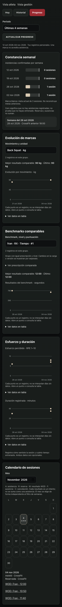
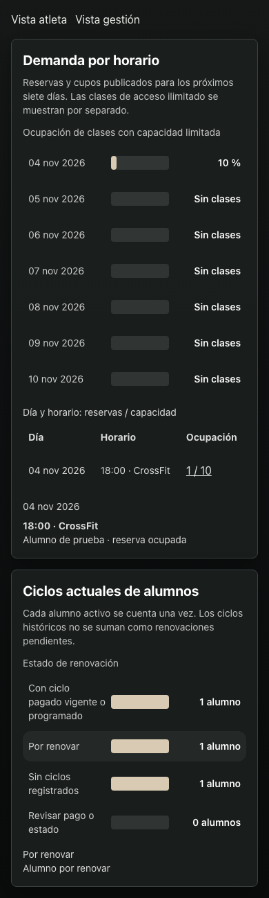

# Etapa 4 — entrenamiento y progreso

Implementada localmente sobre las etapas 1–3 en `feat/etapa-4-entrenamiento`. No publicada en producción; no se aplicaron migraciones remotas ni se escribieron datos reales.

## Puntos 24–30

24. **Entrenamiento:** sustituye la etiqueta WOD en la navegación y reúne Hoy, Historial y Progreso. Se mantienen `/wod`, sus accesos rápidos y las rutas de Mis PR. Atrás/Adelante recuperan la pestaña indicada en la dirección. El entrenamiento del día conserva su estado al cambiar de sección.
25. **Constancia:** barras semanales de asistencias confirmadas, con filtros de 4, 12 y 24 semanas, comparadas con la meta personal actual. Cada barra abre sus asistencias. Reservas, ausencias y resultados de WOD no suman asistencias. Una semana sin asistencias registradas no demuestra que el atleta no entrenó. La línea de meta representa la preferencia actual, no una reconstrucción histórica.
26. **Marcas:** progresión por movimiento y unidad, con mejor resultado y último registro dentro del período. Cada punto abre fecha, resultado y notas; también hay tabla. Menor tiempo es mejor, mayor carga/distancia/calorías es mejor y rondas/repeticiones se comparan por separado. Se conservan cargas decimales. Los antiguos registros `WOD:` sin contexto siguen en Mis PR y no se comparan como movimientos ni benchmarks verificados.
27. **Benchmarks:** el editor permite asignar una referencia estable. Se comparan resultados con la misma referencia, prescripción efectiva, nivel, tipo y unidad. Repetir solo el título no crea una comparación; RX y Scaled permanecen separados. Un cambio de prescripción crea otro grupo. La prescripción comparada se puede consultar. Los resultados anteriores sin referencia no reciben una referencia inventada.
28. **Calendario:** mes independiente del filtro de semanas; distingue asistencia, reserva, resultado, ausencia y cancelación. Seleccionar un día muestra sus registros y permite abrir resultados. Varios intentos del mismo día no se convierten en varias asistencias.
29. **Esfuerzo y duración:** campos opcionales al registrar resultado y gráficos personales independientes. RPE entero de 1 a 10; formulario de duración de 1 a 600 minutos. La base admite duración positiva hasta 600 y valores nulos. No se rellenan datos históricos ni se deducen indicadores de salud.
30. **Gestión:** gráficos bajo el resumen operativo, con demanda de los próximos siete días, detalle por horario y alumnos por estado de ciclo. La ocupación utiliza cupos publicados actuales; excluye acceso ilimitado del porcentaje y lo identifica en la tabla. Las reservas canceladas no ocupan cupo. Cada alumno activo se cuenta una vez en ciclos, sin sumar membresías históricas como nuevas renovaciones pendientes. Los gráficos abren los alumnos o reservas correspondientes y utilizan los permisos y fuentes del panel existente.

## Datos y límites

- La identidad autenticada se verifica antes de leer el historial personal. Sesiones, marcas, asistencias y meta tienen estados de error independientes: un fallo no se transforma en cero ni en un historial vacío.
- Sesiones, marcas y reservas personales se paginan en bloques de 250, con orden estable. El límite de seguridad es 10.000 registros por fuente; al alcanzarlo se muestra error en lugar de presentar un resumen parcial como completo. La asistencia se consulta mediante `get_my_training_attendance`, una proyección privada ligada a `auth.uid()`: `get_my_reservations` filtra desde hoy y la lectura directa de reservas falla con la política recursiva de perfiles vigente. El resumen semanal de Hoy usa la misma fuente histórica. No se reconstruyen registros eliminados.
- Los puntos representan registros reales de las fuentes, sin líneas que interpolen días sin datos. Un solo punto no se presenta como tendencia. En rondas, la altura representa rondas completas y el detalle conserva las repeticiones adicionales.
- Los nuevos campos conservan las políticas de acceso por propietario de la etapa 1. Gestión no añade acceso a perfiles o resultados personales de otros atletas.
- No se añaden dependencias de gráficos ni datos de demostración al producto. Las capturas de abajo proceden de fixtures aislados con respuestas simuladas.

## Verificación

- `npm run lint`, suite general `npm test`, compilación `npm run build` y seis pruebas de nómina aprobadas.
- 14 pruebas de navegador aprobadas entre etapas 1–4 y PWA. La etapa 4 verifica grupos comparables, cambios de período, apertura de registros, calendario, Atrás/Adelante, persistencia del formulario de esfuerzo/duración, errores de fuente, historial vacío y detalle de Gestión.
- Revisión visual de Progreso y Gestión a 390 × 844, sin desbordamiento horizontal. Gráficos con controles de teclado y tablas alternativas; no se declara una auditoría completa con lector de pantalla.
- Pruebas de PostgreSQL local: migración repetible, límites de campos, valores opcionales, aislamiento entre propietarios y denegación a anónimos.
- Pruebas de interfaz con respuestas simuladas y service worker bloqueado en esos recorridos. La prueba adicional de PWA registra el worker local real. No sustituyen validación autenticada contra staging ni una actualización desde una instalación de producción anterior.

## Activación pendiente

La base local declara 2.1.2 y el despliegue auditado 2.1.3. Integrar las cuatro etapas sobre la fuente exacta vigente antes de publicar, conservando los cambios de horarios y nómina privada presentes en producción.

Aplicar y validar en staging las migraciones, en este orden, antes del frontend:

1. `20261104120000_training_reliability.sql` — resultados y contexto del entrenamiento.
2. `20261104140000_metrics_and_member_privacy.sql` — preferencias y privacidad.
3. `20261104160000_training_session_metrics.sql` — esfuerzo y duración opcionales.
4. `20261104170000_training_attendance_history.sql` — historial privado de asistencia compatible con la política existente.

El service worker identifica esta versión como `v20261104-stage4-history`. Antes de producción, verificar cuentas por rol, registros reales, más de una página de historial, un benchmark repetido con referencia coherente y actualización de una instalación anterior. La reversión del frontend no requiere borrar datos de entrenamiento ni preferencias.

## Capturas con datos de prueba

