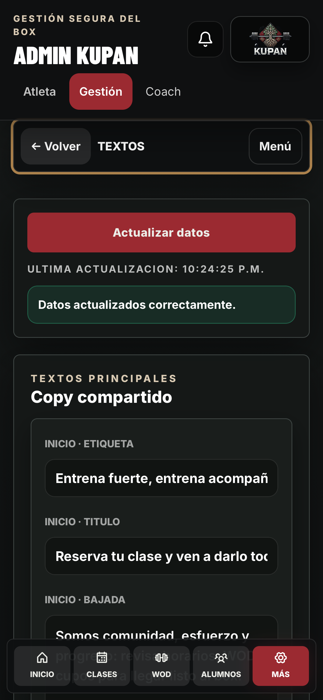

# KUPAN 2.2.3 — navegación móvil de Gestión

## Corrección

El menú lateral tenía posición sticky y altura limitada en todos los tamaños. En móvil quedaba sobre el espacio de trabajo después de elegir un acceso rápido. Ahora el menú ocupa una vista propia: elegir cualquier opción lo cierra y muestra la sección con todo el ancho y desplazamiento de página normal. La barra compacta permite volver al menú o cerrarlo conservando los borradores montados. Se mantiene la navegación inferior y el menú lateral colapsable en escritorio.

El desplazamiento a formularios e historial descuenta la altura real de la cabecera y de la barra de Gestión. La altura se actualiza al cambiar el tamaño; en horizontal, cuando la cabecera deja de ser fija, la barra se ubica en el borde superior. Se mantienen la búsqueda de alumnos, los filtros, la recarga y los mensajes de estado dentro del espacio de trabajo.

## Validación previa

- `npm run lint`, `npm test`, `npm run build`, `git diff --check`: aprobados.
- `npm run test:e2e:mobile-admin`: diez recorridos aprobados entre Chromium/Pixel y WebKit/iPhone simulados. Incluyen 390×844, 320×568, 844×390, las siete familias de accesos, Nuevo alumno, Plan actual, Historial, reapertura sin perder texto, final del formulario por encima de la navegación, menú Más y escritorio a 1440×1000.
- Cinco recorridos de `stage3-flows` aprobados: sesión, destinos, foco, formularios, actualización de PWA y texto al 200 %.
- Ocho comprobaciones públicas/PWA aprobadas. Se corrigen expectativas antiguas de la suite pública para la ruta `login?returnTo` y el texto actual de registro.
- Las pruebas nuevas interceptan Supabase con datos ficticios y bloquean mutaciones inesperadas. No se crean alumnos, membresías, pagos ni reservas reales.
- La simulación de WebKit no sustituye una prueba en un iPhone físico ni comprueba su teclado real.

## Publicación

Versión 2.2.3 y worker `v20261105-mobile-navigation`. Solo frontend; no requiere migraciones de base de datos ni desplegar funciones.

El despliegue anterior de reversión es `dpl_Gxpvsb4TuPLSvXFnCvr3nFnX8nKk`, versión 2.2.1. La publicación final se detalla a continuación.

## Anclaje de navegación inferior

La comprobación autenticada tras la publicación inicial 2.2.2 identificó un problema previo adicional: la animación de entrada retenía una transformación identidad y convertía el contenedor de página en referencia de posición para la barra fija. Se elimina la retención del último fotograma usando `backwards`. La prueba reforzada reproduce primero el fallo contra 2.2.2 y exige después que la barra quede completamente dentro del viewport en cada sección, a menos de 110 px del borde inferior. El ajuste se entrega como 2.2.3.

## Activación final verificada

- Código `3d31905`, respaldado en `origin/release/etapas-1-4`.
- Producción: https://kupan-box-app.vercel.app, versión 2.2.3.
- Despliegue `dpl_DMXp1DNBCAC7brq7tnm55KnXJYqe`, URL inmutable https://kupan-box-2fsm7givh-kupan-s-projects.vercel.app.
- Diez recorridos locales reforzados aprobados tras el ajuste de animación. Las pruebas de 390×844 para ambos motores se repiten contra el dominio publicado: dos aprobadas, recorriendo diez accesos cada una y comprobando la barra completamente dentro del viewport.
- Sesión administrativa existente de Chrome conservada, aviso de actualización aceptado y versión 2.2.3 visible. Nuevo alumno cierra el menú y permite trabajar en el formulario. Barra inferior real entre y=770 e y=836 dentro de un viewport de 844 px; menú oculto. No se envió el formulario ni se crearon registros de prueba reales.
- Captura de la comprobación remota con WebKit y datos simulados: `navegacion-movil-2.2.3.png`.

