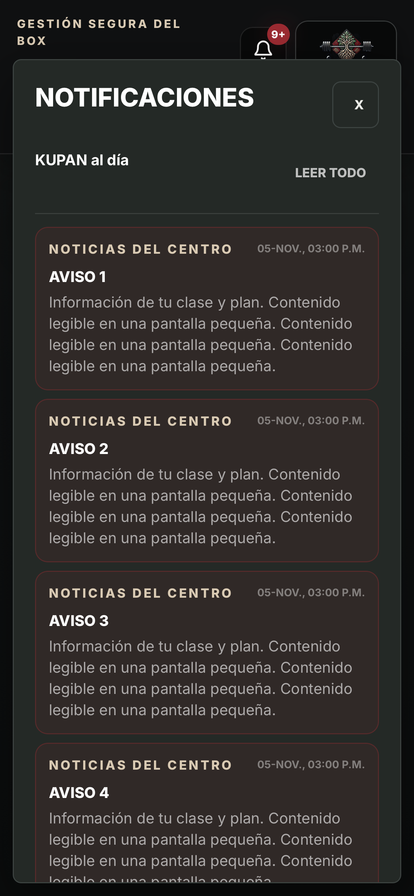

# KUPAN 2.2.4 — reservas manuales y notificaciones

## Diagnóstico verificado

Los errores PostgreSQL de los intentos reportados incluyen `P0001: La reserva está fuera del período permitido.` La función `admin_reserve_for_student`, compartida por Gestión y Coach, aplicaba a la carga manual el cierre de 15 minutos previo al inicio. El mensaje de dominio se convertía en un error genérico y el botón de Coach recargaba el tablero en vez de corregir o repetir la operación correspondiente.

Se identificó además un impedimento para el rol Coach real: el trigger `guard_reservation_write` restringía la inserción a Admin o al propio alumno, pese a que la RPC ya autorizaba explícitamente a Coach.

La campana anclaba un panel absoluto de hasta 22 rem al borde derecho del botón, situado antes del logo. En móvil parte del panel quedaba fuera del borde izquierdo.

## Cambios

- La carga manual de personal permite inscribir en cualquier clase de hoy, incluso iniciada. Conserva el día de semana, fecha entre hoy y la ventana habilitada, perfil activo, plan pagado y vigente, límite Full, cupos, prevención de duplicados y bloqueos de concurrencia. `reserve_class` para alumnos conserva su cierre anticipado.
- Se elimina el veto heredado `activated_at + 30 días`, que podía invalidar un ciclo extendido pese a conservar vigencia. Se comprueban las fechas del ciclo.
- El guard de INSERT reconoce al personal ya autorizado. No se agregan grants ni políticas. El instalador exige que las políticas INSERT/ALL sigan siendo exclusivas de Admin, de modo que Coach no pueda saltarse la RPC con una inserción directa. UPDATE conserva su implementación anterior.
- Las validaciones conocidas tienen mensajes revisados en español. No se exponen detalles SQL desconocidos. El error queda junto al formulario y se conservan las opciones elegidas.
- El reintento de carga de alumnos en Coach recarga sus opciones, no el tablero. Se bloquea confirmar mientras faltan las opciones.
- Notificaciones usa el diálogo compartido mediante portal al cuerpo de la página, ancho y altura limitados al viewport, fondo opaco, scroll, cierre explícito, Escape, foco contenido y retorno a la campana en Safari.

## Pruebas

- Lint, suite general y compilación aprobados. Se fija America/Santiago en la prueba de privacidad para evitar que las reservas de prueba queden en el día siguiente después de medianoche UTC.
- PostgreSQL temporal reproduce el rechazo previo. Comprueba Admin y Coach, Full sin cargo, plan finito con un único cargo, falta de tokens, duplicados, cupos, vigencia, fechas y roles. Una inserción directa de Coach sigue denegada. El instalador compacto produce exactamente las funciones de la migración canónica y admite repetición; registro de migración único.
- Doce recorridos en Chromium/Pixel y WebKit/iPhone simulados: campana en 320×568, 390×844, 844×390 y 1280×900, acceso a la última de veinte notificaciones, cierre y foco, reserva desde Gestión/Coach, mensaje de rechazo sin pérdida de selección y recuperación del loader. Dos recorridos adicionales verifican el acabado visual final a 390×844.
- No equivalen a una prueba con teclado de iPhone físico.

## Base de datos publicada

La copia previa exacta de ambas funciones, sin datos personales, está en `tests/fixtures/manual-reservation-before.sql` y el rollback en `supabase/rollbacks/20261105230000_manual_staff_reservations_rollback.sql`.

La reparación se probó primero en producción dentro de `BEGIN`/`ROLLBACK`, con un Admin y un alumno con Full existentes, en una clase ya iniciada de hoy. Se verificó una reserva adicional, cero cambio en tokens y rechazo de duplicado. Todos los cambios de esa prueba se revirtieron.

Se aplicó atómicamente `supabase/releases/20261105_manual_staff_reservations.sql` y se registró `20261105230000` en el historial. El instalador verifica las huellas de origen para impedir sobrescribir una función cambiada durante el trabajo. Huellas finales verificadas:

- `admin_reserve_for_student`: `0076acb69c0bee3cf38d5b50c86cdaf0`.
- `guard_reservation_write`: `c12093b674285a8f8058921f13f84e2c`.

Solo se conservan las funciones y el registro de migración; no se conservó ninguna reserva o movimiento de prueba. No se despliegan Edge Functions ni se modifica FITTEST.

## Interfaz

Versión 2.2.4, worker `v20261105-staff-notifications`. Publicada en https://kupan-box-app.vercel.app.

## Comprobación final en producción

- Código `fbb4c36`; despliegue `dpl_81PM6jCS5E5cPwMBNrmKutsUP3VR`, URL inmutable https://kupan-box-okjkegsyz-kupan-s-projects.vercel.app.
- Los doce recorridos se repiten contra el dominio público, con Supabase interceptado y datos ficticios: doce aprobados.
- Sesión administrativa de Chrome conservada tras activar el aviso de actualización a 2.2.4. Campana real completamente dentro de 390×844: x=12 a x=378, y=55.52 a y=832. No se marcaron notificaciones como leídas durante la comprobación.
- Coach carga sus catorce perfiles reales y habilita Confirmar alumno. No se envió una reserva real desde el navegador.
- La captura siguiente procede de la prueba remota WebKit con avisos ficticios, sin datos personales.

